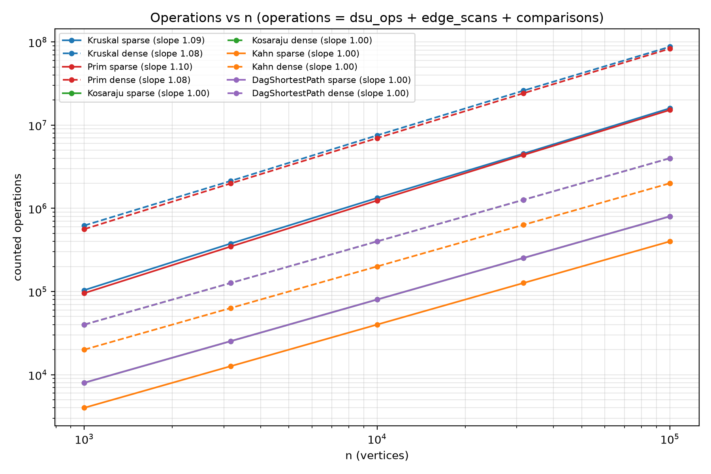
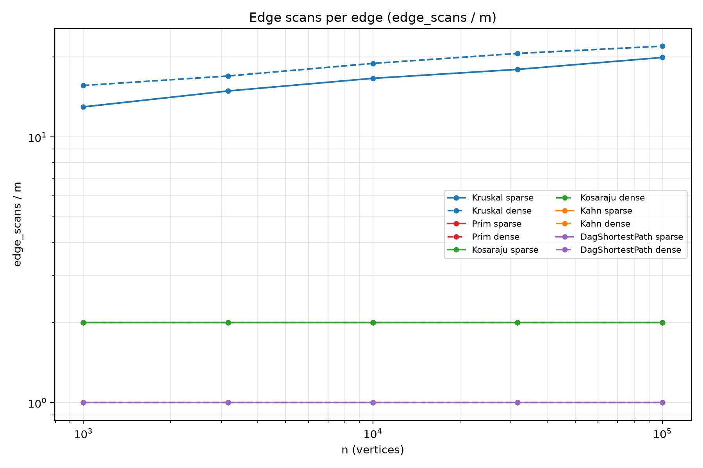
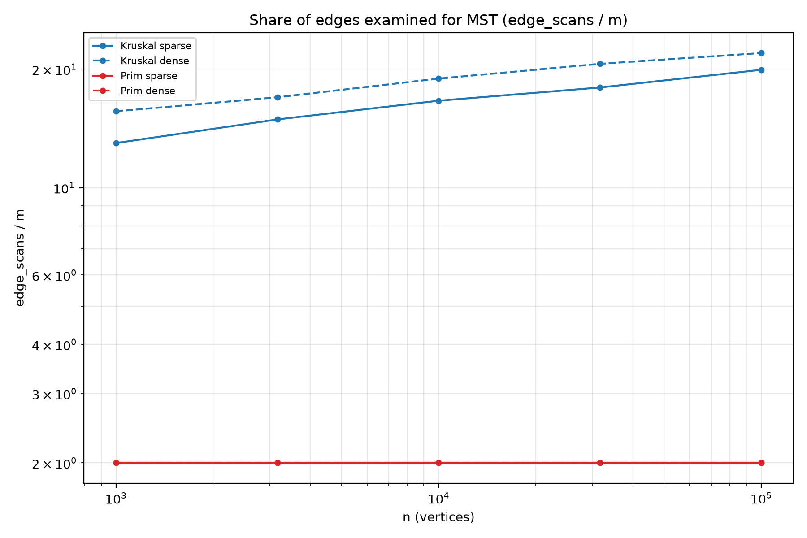
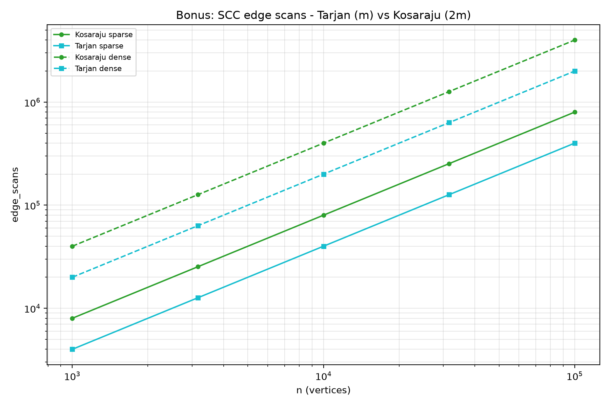

# DAA Assignment 3 - Graphs: DSU, MST, SCC and Shortest Paths

**Scenario: City Network & Job Scheduler.**
The road department wants the cheapest set of roads that keeps every district reachable (minimum spanning tree / forest), the scheduler wants the order in which dependent jobs may run and the jobs that form a deadlock (topological order and strongly connected components), and the pipeline wants the fastest route between dependent stages (shortest paths in a DAG). All six algorithms run on one adjacency-list `Graph` class, every algorithm counts its own operations, and one benchmark command reproduces every number in this report.

**Bonus tasks:** Tarjan's SCC and the condensation graph with its critical path are implemented as well.

---

## 1. Complexity Table

Let `V = n` be the number of vertices, `E = m` the number of edges, and `α` the inverse Ackermann function (`α(n) ≤ 4` for every practical `n`).

| Algorithm | Time | Extra space | Justification |
|---|---|---|---|
| DSU `find` | `O(α(n))` amortized | `O(1)` | path compression flattens the tree; union by rank keeps its height `O(log n)` before compression |
| DSU `union` | `O(α(n))` amortized | `O(1)` | two `find` calls plus one pointer and one rank update |
| DSU `makeSet` / `components` | `O(n)` / `O(1)` | `O(n)` | one array for parents and one for ranks; the component count is a counter |
| Kruskal | `O(E log E)` | `O(V + E)` | stable merge sort of the `E` edges dominates; the DSU pass adds `O(E α(V))` |
| Prim (lazy, binary heap) | `O(E log E)` | `O(V + E)` | every edge enters the heap at most once, every heap operation costs `O(log E)`; `O(V)` for the visited array |
| Kosaraju (iterative) | `O(V + E)` | `O(V + E)` | two full DFS passes; the transpose is built once in `O(V + E)` |
| Kahn | `O(V + E)` | `O(V)` | in-degree array plus FIFO queue; each edge is relaxed exactly once |
| DAG shortest paths | `O(V + E)` | `O(V)` | one relaxation pass over edges in topological order |
| Tarjan (bonus) | `O(V + E)` | `O(V)` | single DFS with `index[]`, `lowlink[]` and an active stack |
| Condensation + critical path (bonus) | `O(V + E)` | `O(V + E)` | Tarjan, one transposed/condensed edge scan, then one DAG longest-path pass |

Iterative DFS is used everywhere; the explicit stack depth is measured as `maxDepth`, which is why the 100 000-vertex path test cannot overflow the JVM stack (it would with recursion).

## 2. What Each Counter Means (counted inside the algorithms)

* `dsu_ops` = `find` calls + **successful** `union` calls, incremented inside `Dsu`. Each Kruskal edge calls `union`, which performs exactly two `find`s; merged edges add one union. For a connected graph this is exactly `2m + (n - 1)`.
* `edge_scans` = edges / adjacency entries *looked at*:
  * Kruskal: every element read during the merge-sort passes plus the final scan, i.e. `m · (1 + ⌈log₂ m⌉)`;
  * Prim: every adjacency entry examined (including entries popped stale from the heap);
  * Kosaraju: exactly `2m` (one out-edge scan per pass); Kahn, DAG shortest paths, Tarjan: exactly `m`.
* `comparisons` = weight comparisons: merge-sort key comparisons (Kruskal), priority-queue comparator calls (Prim), relaxation checks (DAG shortest paths, one per edge).
* `max_depth` = deepest the explicit DFS stack ever got (Kosaraju, Tarjan); 0 for the non-DFS algorithms.
* Setup work that is part of the *stage*, not of the algorithm (in-degree arrays, graph transpose, condensation construction) is not counted as an edge scan, except for the condensation, where scanning the original edges *is* the algorithm. The benchmark asserts that counters are identical across the 5 runs.

## 3. Counters vs Formulas

Formulas: `2m + (n − 1)` for Kruskal DSU work, `m · log₂ m` for Kruskal sorting scans, `2m` for Prim and Kosaraju scans, `m` for Kahn and DAG-relaxation scans.

| Algorithm | Ratio | n = 1 000 sparse | n = 100 000 sparse | n = 1 000 dense | n = 100 000 dense |
|---|---|---|---|---|---|
| Kruskal | `dsu_ops / m` | 2.2498 | 2.2500 | 2.0500 | 2.0500 |
| Kruskal | `edge_scans / (m · log₂ m)` | 1.085 | 1.071 | 1.094 | 1.050 |
| Prim | `edge_scans / (2m)` | 1.000 | 1.000 | 1.000 | 1.000 |
| Kosaraju | `edge_scans / (2m)` | 1.000 | 1.000 | 1.000 | 1.000 |
| Kahn | `edge_scans / m` | 1.000 | 1.000 | 1.000 | 1.000 |
| DagShortestPath | `comparisons / m` | 1.000 | 1.000 | 1.000 | 1.000 |

The `dsu_ops / m` ratio is exactly `2 + (n − 1)/m`, i.e. constant `2.25` (sparse, `m = 4n`) and `2.05` (dense, `m = 20n`). Kruskal's scan ratio stays inside `1.05 – 1.09` of `m log₂ m`; the drift is the `⌈·⌉` in the merge-sort level count and lower-order terms. Prim, Kosaraju, Kahn and the DAG relaxation hit their formulas exactly — a ratio that does not move as `n` grows by a factor of 100 is the empirical confirmation of the complexity class.

## 4. Slope Check (log-log fits of `edge_scans`)

| Curve | n = 10³ → 10⁵, sparse | dense |
|---|---|---|
| Kosaraju | **1.000** | **1.000** |
| Kahn | **1.000** | **1.000** |
| DagShortestPath | **1.000** | **1.000** |
| Prim | **1.000** | **1.000** |
| Kruskal | **1.091** | **1.076** |

The traversals give a straight line of slope 1.00 — linear work. Kruskal is slightly steeper because its scan count carries the `log` factor of `E log E` (each merge-sort level reads every edge once). Fitting the *total operations* curves instead (see plot 1) also puts Prim at 1.101 / 1.085: its priority-queue comparator calls add another `E log E` term on top of the linear `2m` scans.

## 5. Correctness Arguments

**Cut property (Kruskal and Prim).** For any cut `(S, V∖S)` of an undirected graph, the lightest edge crossing the cut is safe: some MST contains it. Take any MST `T` that avoids the lightest crossing edge `e = (u, v)`. Adding `e` to `T` creates a cycle, and that cycle must cross the cut at least twice — `e` crosses it, so some other edge `f` of the cycle also crosses it. Every crossing edge weighs at least as much as `e`, so `w(f) ≥ w(e)`; replacing `f` by `e` yields a spanning tree of weight `w(T) − w(f) + w(e) ≤ w(T)`, hence an MST that contains `e`. Kruskal invokes the property with `S` = one of the two components joined by the edge it is considering: all lighter edges were already processed, and none of them connects `S` to the rest, so the current edge is the lightest edge across that cut. Prim invokes it with `S` = the vertices already in the tree: the heap always returns the lightest edge crossing the cut, so again only safe edges are added. Induction over the chosen edges shows both produce an MST; on a disconnected graph the same argument runs per component, so both return a minimum spanning forest with the same total weight and the number of components is reported instead of an exception.

**Induction on the topological order (DAG shortest paths).** Claim: when the relaxation loop reaches the `i`-th vertex `v` of the topological order, `v`'s distance is final for every not-yet-processed vertex as well. Base: the loop is correct at step 0 because every in-degree-0 vertex is initialized to `0`, and every path in a DAG starts at an in-degree-0 vertex (walking backwards along incoming edges must stop). Step: take the `(i+1)`-th vertex `v`. Every path ending at `v` uses an incoming edge `u → v`; by the topological property `u` was processed earlier, and by the induction hypothesis `dist[u]` was already final then, so the relaxation of `u → v` computed the exact candidate `dist[u] + w(u, v)`. The loop relaxes *all* incoming edges of `v` before moving on (every edge is relaxed exactly once, when its tail is processed), so `dist[v]` equals the minimum over all incoming candidates — the shortest distance to `v`. Nothing processed later can lower `dist[v]`, because any path to `v` must enter through one of those already-checked edges. Hence a single pass suffices. Negative weights are safe here because the process never revisits a vertex: in a graph with cycles a cheaper path to an already-processed vertex may appear later (that is why Bellman-Ford needs `V − 1` rounds), but in a DAG every edge points strictly forward in the order, so there is no "way back". The super-source initialization makes the result independent of which vertex you happen to pick and keeps the whole DAG reachable.

## 6. Which Algorithm When

| Situation | Pick | Why |
|---|---|---|
| Sparse graph (`m ≈ 4n`), MST | **Kruskal** | work is `E log E` on the edge list plus `2m` near-constant DSU operations; measured `dsu_ops / m = 2.25` |
| Dense graph (`m ≈ 20n`), MST | **Prim** | touches every adjacency entry exactly twice (`2m` scans) and never sorts; on our dense 100 000-vertex graph Prim and Kruskal end up at comparable total operations, but Prim does no global sort when edges arrive as adjacency lists |
| Edges come as an edge list; output should be an edge list | **Kruskal** | the input list is directly sortable; no adjacency structure needed |
| Edges come as an adjacency list; graph connected | **Prim** | grows one tree from a seed vertex, memory local to the frontier |
| Disconnected input | either | both return a minimum spanning forest and the component count; no exception |
| Directed graph, SCCs needed | **Kosaraju** (required) or **Tarjan** (bonus) | Kosaraju scans `2m` (two passes, needs transpose); Tarjan scans `m` in one pass |
| Cycle possible, need an execution order | **Kahn** | in-degrees expose a cycle explicitly (fewer than `n` vertices leave the queue) instead of returning a wrong order |
| No cycles (DAG), shortest paths, negative weights allowed | **DAG relaxation** | one `O(V + E)` pass; Dijkstra needs non-negative weights, Bellman-Ford costs `O(VE)` |
| No cycles (DAG), longest path / critical path | **relaxation with flipped signs** on the DAG (bonus) | the topological order makes the recursion acyclic; in a general graph longest path is NP-hard |
| General graph, shortest paths | Dijkstra (no negative weights) or Bellman-Ford (negative allowed) | outside this assignment, listed for contrast |

## 7. Plots

*Operations vs n* — one line per algorithm and density, log-log axes. Traversals (Kosaraju, Kahn, DagShortestPath) and Prim's scans are straight lines of slope 1.00; Kruskal and Prim-with-queue-comparisons are slightly steeper (`E log E`).

*Scans per edge* — `edge_scans / m` vs n. Prim and Kosaraju are flat at 2.0 (each adjacency entry/out-edge is touched twice), Kahn and the DAG relaxation are flat at 1.0 (exactly one scan per edge) — the confirmation of linear work.

*Share of edges examined for MST* — `edge_scans / m` for Kruskal and Prim. This is where the MST algorithms differ: Prim touches each edge at most twice (flat at 2.0), while Kruskal reads every edge once per merge-sort level, so its share grows like `log₂ m` and the dense line runs above the sparse one. Kruskal wins when edges are pre-sorted or the graph is sparse; Prim wins when the graph is dense and the edge list is expensive to sort.

## 8. One Paragraph on Time

The measured wall-clock times (median of 5 runs) are noise on the two smallest graphs (sub-millisecond) and reach about 0.7 s for Kruskal, 2.8 s for Prim, 0.26 s for Kosaraju, 0.05 s for Kahn and 0.05 s for the DAG relaxation on the dense 100 000-vertex graphs. The ordering agrees with the counters — Prim's time is dominated by ~79 million priority-queue comparisons, the traversal algorithms stay near linear — but the clock is not evidence: it depends on this laptop, the JDK build, JIT warm-up and background load, and two of the five sizes are too small for the timer to be meaningful. The counters, by contrast, are identical on every machine for the same seeded graphs, so all conclusions above are drawn from them; the times are reported only because the CSV format asks for a `time_ms` column.

## 9. Bonus: Tarjan and Condensation

**Tarjan's SCC.** Tarjan finds all strongly connected components in a single DFS pass with `index[]` (discovery time), `lowlink[]` (smallest index reachable) and a stack of active vertices; a vertex whose `lowlink` equals its `index` pops its whole component. The saving over Kosaraju is structural: Kosaraju needs a first pass for the finish order, a transposed graph, and a second pass — exactly `2m` edge scans (measured: 800 000 vs 400 000 at sparse `n = 100 000`, 4 000 000 vs 2 000 000 at dense, always exactly half). Tarjan pays `O(V)` extra memory for `index`, `lowlink` and the active stack, and its implementation is iterative here to survive the 100 000-vertex path (`maxDepth = 100 000`). Both return identical component partitions on every test graph (asserted in the tests and in the benchmark).

**Condensation and the critical path.** The condensation graph contracts every SCC into one vertex; since all cycles live inside components, the result is always a DAG (the benchmark re-checks this with Kahn). The longest path in the condensation is computed by relaxing edges in topological order with the sign flipped — literally the same `O(V + E)` DAG pass used for shortest paths, so negative "weights" are fine. The longest path is easy in a DAG because the topological order gives every vertex its final value in one sweep; in a general graph the same problem is NP-hard (its decision version contains Hamiltonian path). Critical paths are what scheduling runs on: in a project DAG with task durations, the longest path from a source to a sink is the minimum possible project duration, and every task on it has zero slack — a delay anywhere on the critical path delays the whole project. On the sparse directed graphs the tool reports a critical path of 8 components and 4 977 weight units at `n = 100 000`; on the dense graphs the whole graph is one SCC (component count 1), so the condensation has a single vertex and the critical path is trivially 0.
